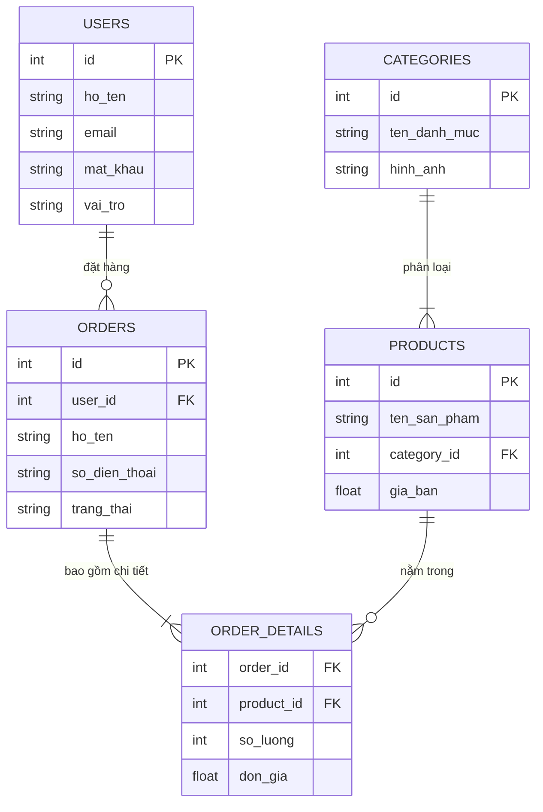

# Dự án Quản lý Cửa hàng Nông sản (AgriMarket)

## Sơ đồ Cơ sở dữ liệu (Database ERD)
Dưới đây là sơ đồ thực thể liên kết (ERD) của cơ sở dữ liệu `nongsan_db` thể hiện cấu trúc các bảng:



## Sơ đồ Kiến trúc Hệ thống (System Architecture)
Sơ đồ dưới đây thể hiện luồng giao tiếp từ Giao diện người dùng (Frontend) kết nối qua API (Backend) để tương tác trực tiếp xuống Cơ sở dữ liệu `nongsan_db`:

```mermaid
graph TD
    User((Người dùng)) -- Tương tác --> FE
    
    subgraph Tầng Giao diện (Frontend)
        FE[ReactJS App\n(Giao diện Web: Đăng nhập, Đặt hàng...)]
    end
    
    subgraph Tầng Xử lý (Backend)
        BE[Node.js & Express\n(Xử lý Logic, Authentication & Routing)]
    end
    
    subgraph Tầng Dữ liệu (Database)
        DB[(MySQL Database\n'nongsan_db')]
    end

    FE -- "Gửi HTTP/API Request\n(fetch dữ liệu từ localhost:5000)" --> BE
    BE -- "Thực thi truy vấn SQL\n(SELECT, INSERT, UPDATE, DELETE)" --> DB
    DB -. "Trả kết quả truy vấn" .-> BE
    BE -. "Trả dữ liệu JSON" .-> FE
```